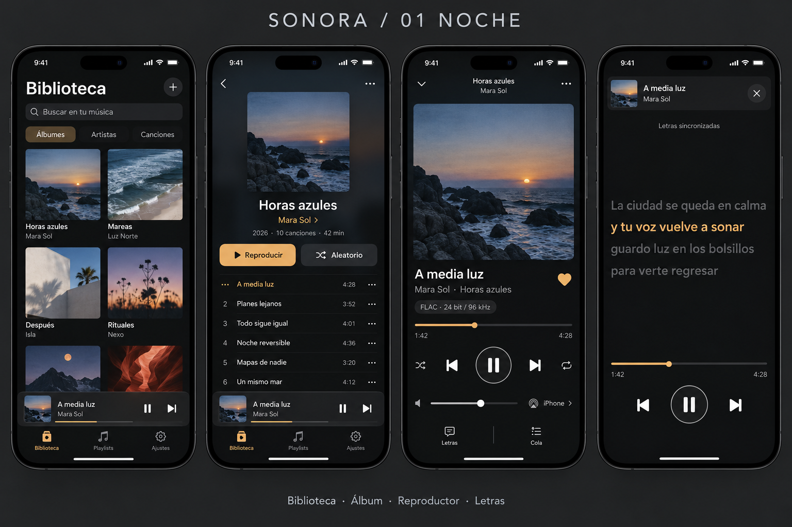
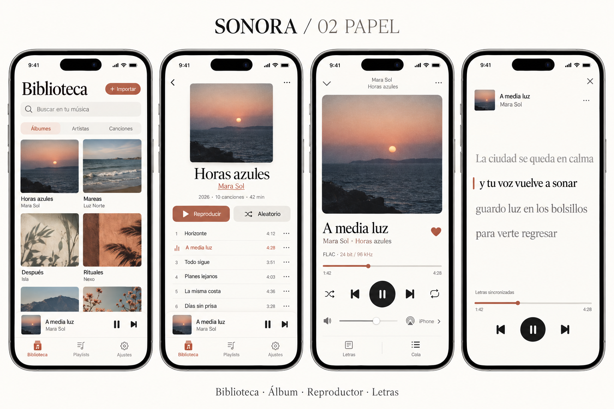
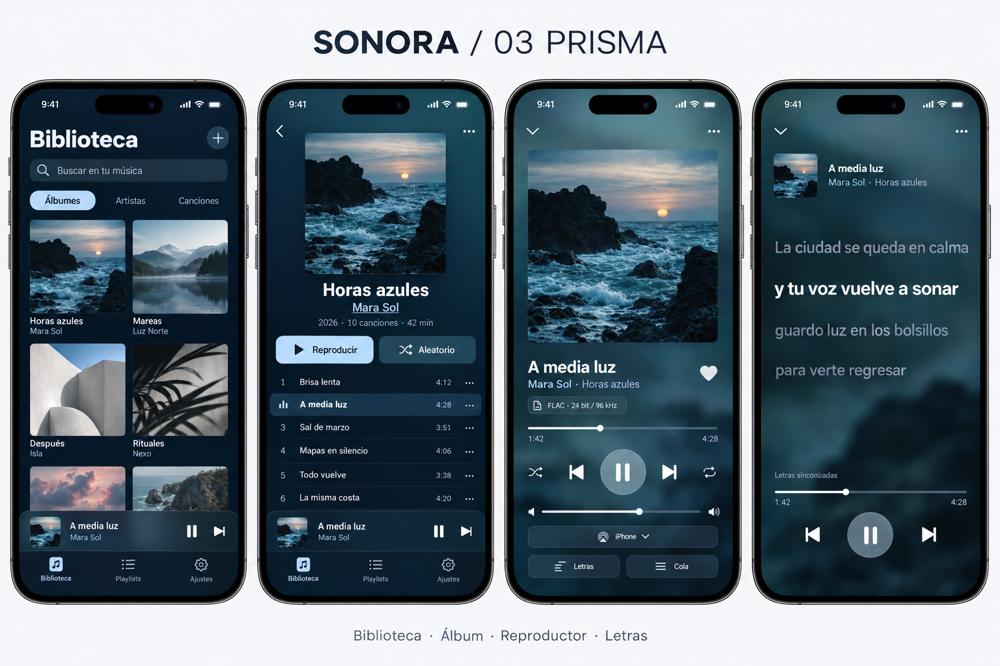

# Sonora visual directions

The selected design combines **Noche for dark appearance** and **Papel for iOS light appearance**. Start with Noche as the default and the first implementation target. Papel defines the corresponding light appearance of the same app. This decision was approved on 2026-10-15.

The three original exploration boards are retained below. Each shows Library, Album, Now Playing, and Lyrics with fictional music. They are visual references, not a working prototype, a format certification, or a final accessibility review.

The first native folder-player build now has separate [runtime screenshots](../screenshots/README.md). Those show the implemented Noche/Papel interface with synthetic audio; the boards below retain the broader product direction.

The interface copy is Spanish for this review. Project documentation is English. The sample artist is Mara Sol, the album is Horas azules, and the current song is A media luz. Covers and lyric excerpts are original generated sample content.

## 01 Noche

[Open the full board](01-noche.png)

A near-black library, large cover art, and a small warm accent. Selected for dark appearance and as the default starting point. The artwork is prominent and the controls are easy to find during longer listening sessions.

## 02 Papel

[Open the full board](02-papel.png)

A warm light surface, editorial headings, and restrained separators. Selected for iOS light appearance, paired with Noche. Preserve the editorial character while checking heading sizes, long titles, and accessibility in the real layout.

## 03 Prisma

[Open the full board](03-prisma.png)

A dark library with Now Playing and Lyrics colored from the current artwork. Retained as an unselected exploration; it is not part of the chosen Noche/Papel design.

## Shared design contract

Noche and Papel are two appearances of one interface. Keep navigation, screen hierarchy, available actions, playback state, and control placement consistent. Adapt surfaces, text contrast, accent colors, and heading treatment to their respective reference boards. Both appearances must support the same features.

The original boards illustrate the broader Library/Playlists/Settings product. In the agreed first version, selecting a folder through Files queues its audio files recursively and plays them in place, advancing automatically through all subfolders. The plus/import action becomes Play Folder. Keep folder browsing, a mini-player/Now Playing, and Queue. The subsequent approved expansion adds working albums, artist pages, playlists and lyrics while retaining Noche/Papel. See the [current feature guide](../library-and-metadata.md) for their native navigation and validation scope.

The `FLAC · 24 bit / 96 kHz` text is fictional source-file metadata. It does not certify a working decoder or describe the actual output path. Lyrics are fictional; timed highlighting is a visual proposal. Mock data and generated labels must not become implementation requirements accidentally.

Next, design folder scanning and its empty/loading/cloud-download/access-error states, the complete recursive queue, unknown tags, missing artwork, and transition controls using Noche first and the same structure for Papel. Keep continuous playback as the proposed default for concerts and make Crossfade an explicit option with a duration control. An additional adaptive AutoMix-style mode is requested if technically viable; expose it only after its behavior is proven and distinguish adaptive analysis from ordinary Crossfade. Artist, search, playlists and lyrics states follow when their scope is added. Recheck all labels, system volume/output controls, Dynamic Type, VoiceOver, contrast, safe areas, and 44-point touch targets in the actual iPhone UI. These boards cannot prove those contracts.

## Generation record

Generated using the built-in image-generation tool. The [exact prompts](prompts.md) are retained for reproducibility. The PNG boards live alongside this file, so they can be reviewed without external asset hosts. Each direction is an independent exploration; sample artwork may differ between directions.
