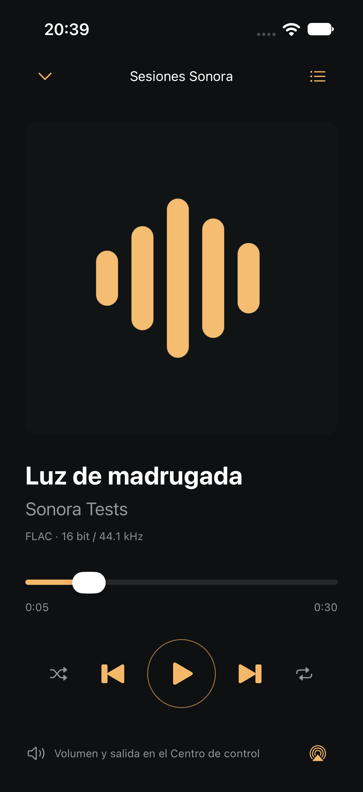
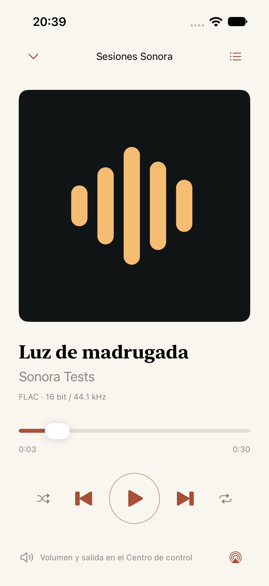

# First native Sonora build

Actual screenshots from the iPhone 17 Simulator running iOS 27.0 on 2026-10-15. These come from the passing `FolderPlayerUITests.testFolderPlaybackBothThemesBackgroundAndRestore` run. The three audio tracks are synthetic 30-second tones with original test metadata; the local cover is Sonora's generated icon. No user music or cloud account is involved.

The newer [EQ and Crossfade gallery](listening-tools/README.md) records the listening controls added on 2026-10-16.

| Noche | Papel |
| --- | --- |
|  |  |

The test opens Files, selects the `Sonora QA` folder, verifies that the first root file and its nested successor are in the queue, then starts playback. It navigates through Now Playing and Queue, changes appearance, backgrounds active playback, and relaunches with the folder bookmark and queue restored in a paused state. Audio and scanner tests separately check actual advancement, sample continuity, seeking, errors, queue mutation, and interruption handling.

| State | Screenshot |
| --- | --- |
| Empty player | [01-empty.png](01-empty.png) |
| Real Files folder selection | [02-files-folder.png](02-files-folder.png) |
| Noche folder and mini-player | [03-library-noche.png](03-library-noche.png) |
| Noche Now Playing | [04-player-noche.png](04-player-noche.png) |
| Recursive queue | [05-queue.png](05-queue.png) |
| Papel folder and mini-player | [06-library-papel.png](06-library-papel.png) |
| Papel Now Playing | [07-player-papel.png](07-player-papel.png) |
| Queue restored without autoplay | [08-restored-paused.png](08-restored-paused.png) |
| Noche player after paused restoration | [09-player-noche-restored.png](09-player-noche-restored.png) |

The source folder is inside the app's simulator Documents directory and is selected through the system File Provider. This proves that UI path and recursive playback; it does not prove signed-in iCloud materialization, revoked external-folder access, physical output routes, or behavior on the minimum iOS runtime. Crossfade, AutoMix-style analysis, and EQ controls are not present in this build.
