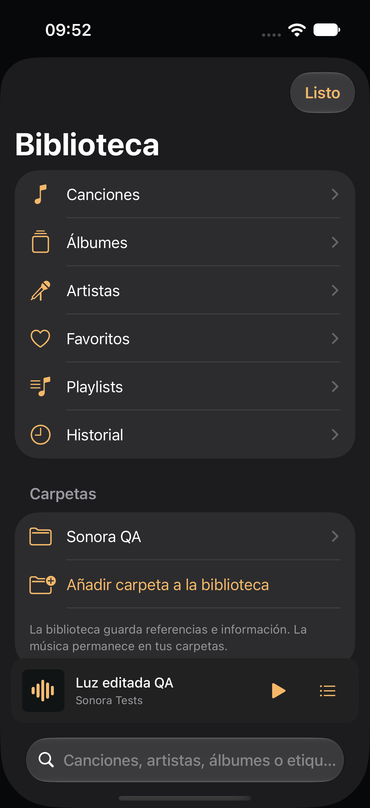
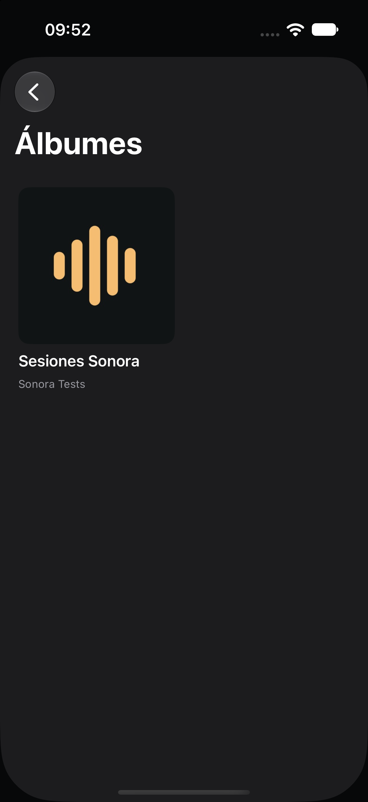
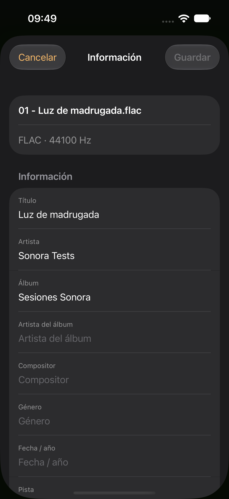
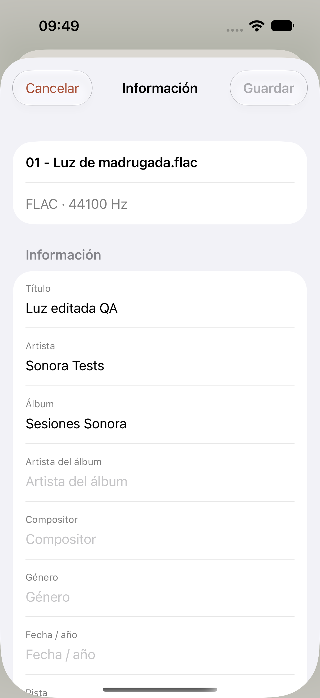
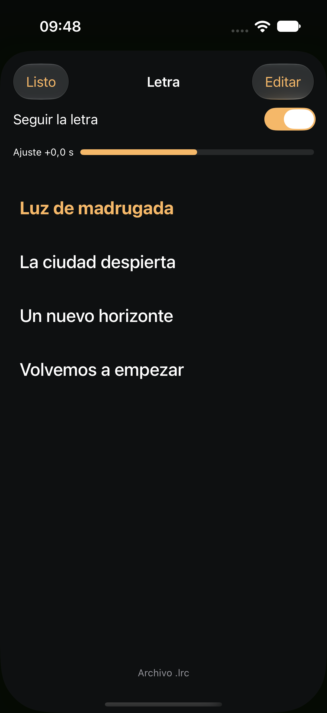
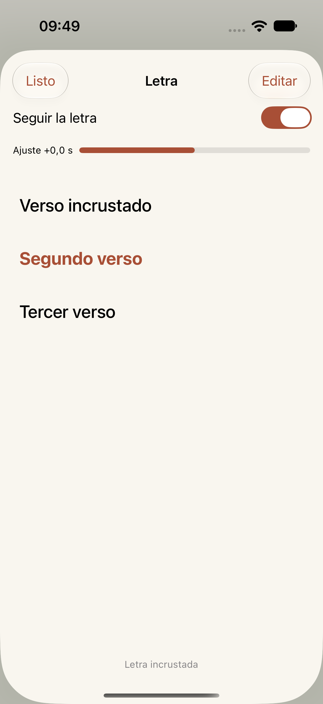
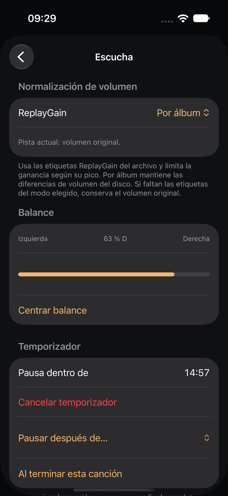
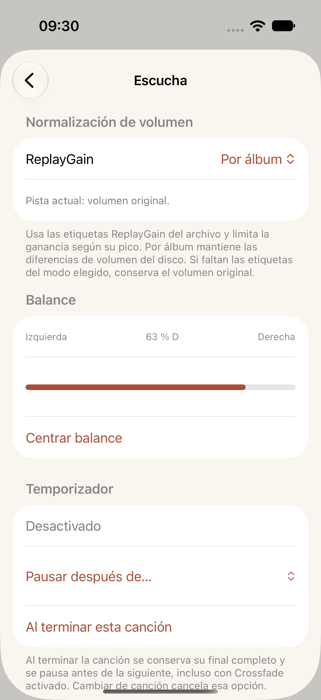

# Library, lyrics and metadata editing

Native iPhone 17 Simulator / iOS 27 captures from the expanded local build, 2026-10-16. The files use synthetic Sonora QA audio and original test lyrics. The images are unedited simulator captures; library navigation was also inspected directly after the final audio run. Their source tests and hashes are in [captures.json](captures.json).

| Screen | Noche | Papel |
| --- | --- | --- |
| Library and album artwork |   | See the Papel examples below. |
| File information editor |  |  |
| Timed lyrics |  |  |
| ReplayGain, balance and timer |  |  |

The lyric screens intentionally show different source states: a sidecar LRC before editing and embedded text after saving and relaunching. The editor also supports multi-selection and per-file save results. No owner's music was modified for these captures.

The [automatic-mix beta controls](adaptive-papel.png) describe the local pulse-alignment behavior and its fallback. It does not change tempo or pitch. See the [feature guide](../../library-and-metadata.md) for formats, original-file writes and validation limits. The separate [EQ/Crossfade gallery](../listening-tools/README.md) and [folder-player gallery](../README.md) record earlier native screens.
