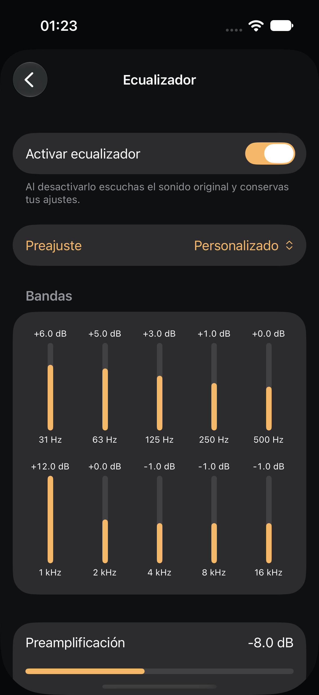
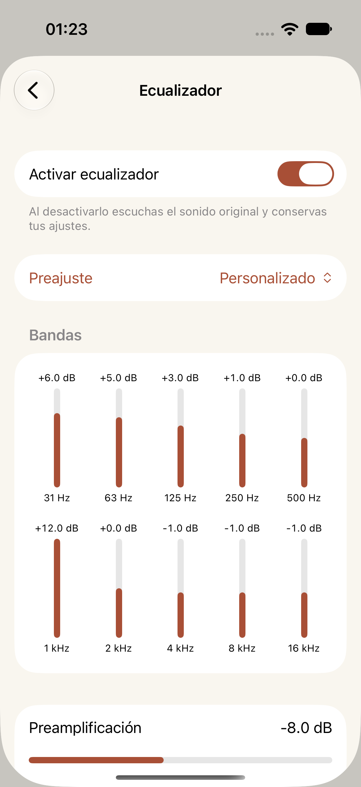
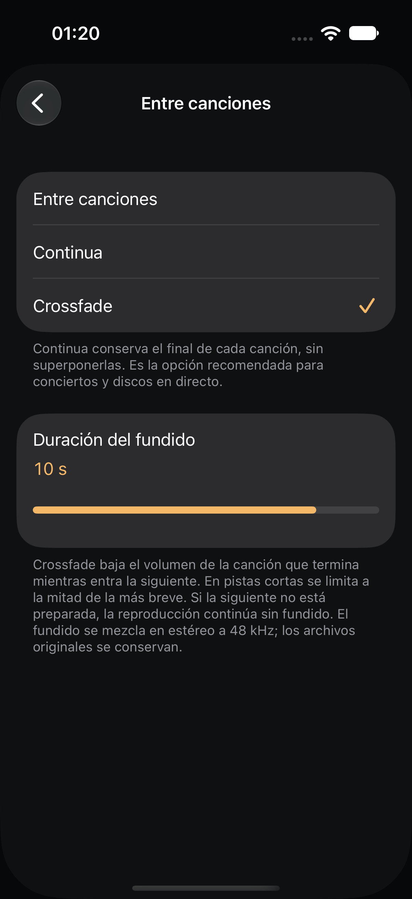
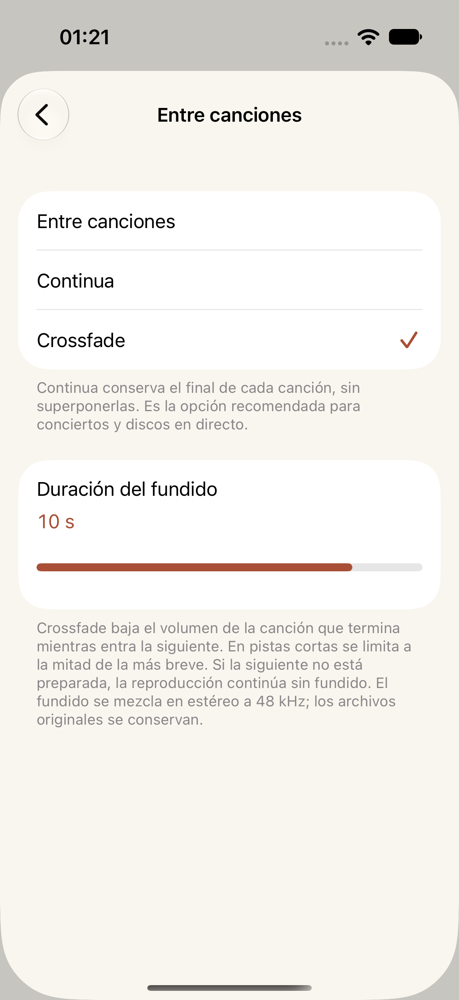

# EQ and Crossfade

Actual iPhone 17 Simulator / iOS 27.0 screenshots from the passing `ListeningToolsUITests` run on 2026-10-16. The tests select presets, drag a band and the duration slider, relaunch to verify persistence, change appearance, and reach the controls at the largest accessibility text size.

| Control | Noche | Papel |
| --- | --- | --- |
| Ten-band EQ and preamp |  |  |
| Optional Crossfade |  |  |

The example EQ curve is a saved manual adjustment. Presets and bypass preserve band/preamp values. Crossfade is optional; [Continua](continuous-papel.png) is the default. Settings screens scroll when needed; the separate Now Playing screen remains fixed, including at the largest text size.

Accessibility captures: [EQ](eq-accessibility.png), [Crossfade](crossfade-accessibility.png). At large sizes, EQ bands use horizontal rows and stacked labels.

Separate audio tests measure actual player output, EQ frequency response, overlap samples, short-track timing, format conversion, queue edits, late preparation, and damaged files. These screenshots use synthetic local fixtures. Signed-in cloud providers and physical audio routes still require validation. This gallery records the earlier EQ/Crossfade build. The [expanded guide](../../library-and-metadata.md) describes current lyrics, metadata editing, listening controls and the limited automatic-mix beta.
