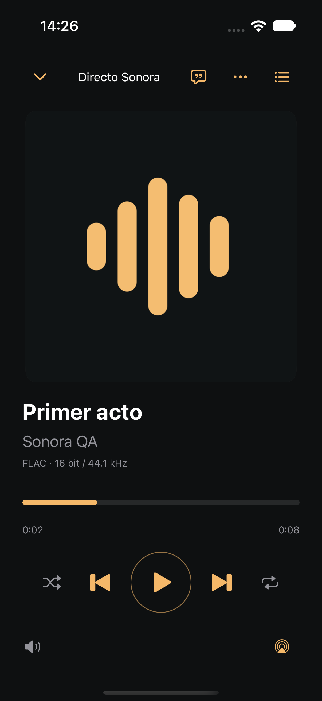
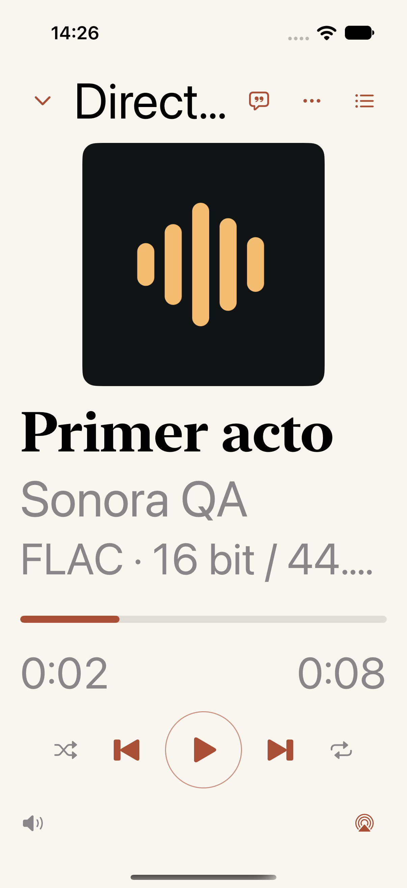
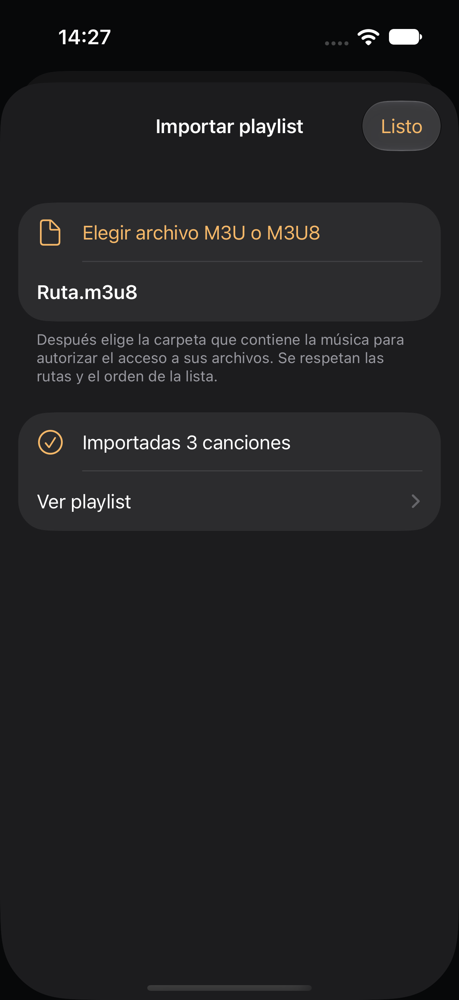
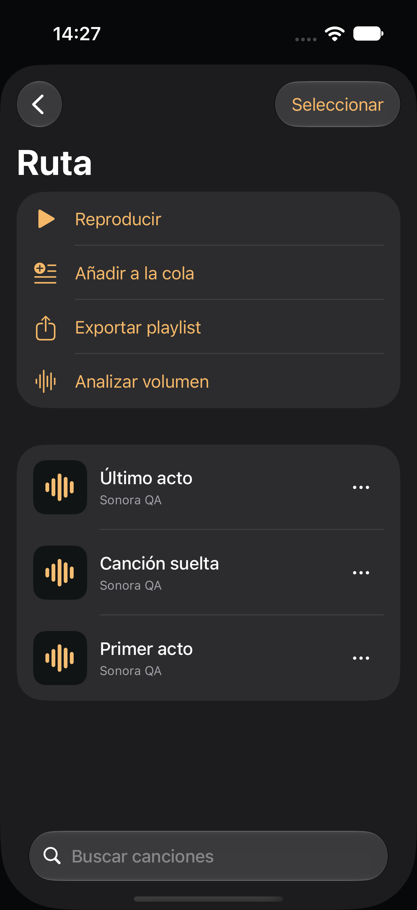
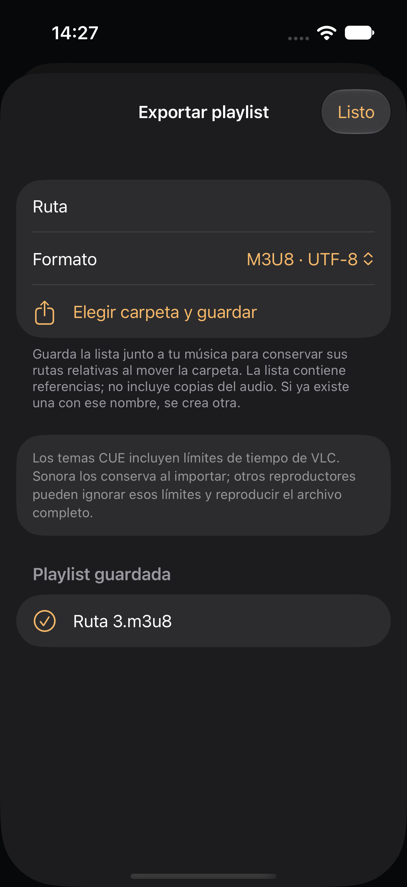
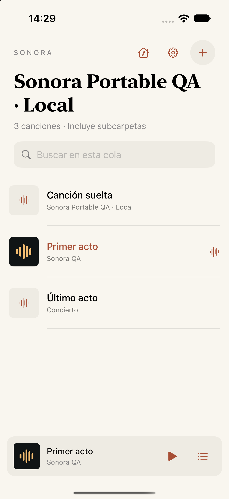
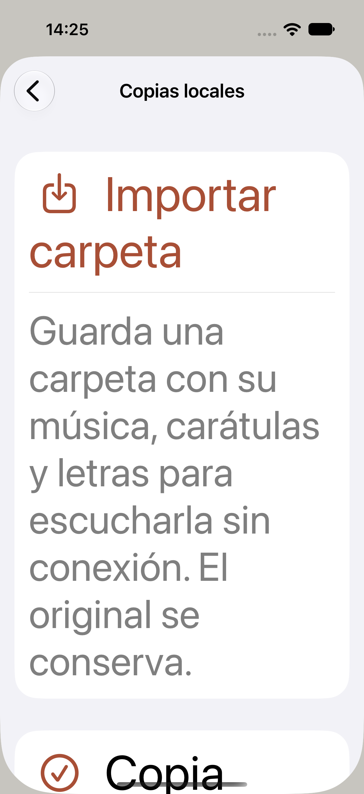

# CUE, playlists and local copies: native screens

Captured from Sonora on iPhone 17 Simulator / iOS 27, 2026-10-16, using synthetic QA music. These are native app captures. The [feature guide](../../portable-library.md) describes supported formats and validation limits; [captures.json](captures.json) records tests, artifact hashes and source provenance.

The final signed Simulator run passed 93 app/audio tests and four UI tests, with no skipped tests, failures or changed source inputs. The Core suite separately passed 23 tests. CarPlay has native template and transport tests, but its external Simulator display remained black; no CarPlay screenshot or visual head-unit validation is claimed.

| CUE restored paused in Noche | CUE in Papel at maximum text size |
| --- | --- |
|  |  |

| M3U8 imported from Files | Ordered playlist with individual CUE songs |
| --- | --- |
|  |  |

| M3U8 export completed | Local copy queue after normal relaunch |
| --- | --- |
|  |  |

The local-import form supports maximum accessibility text and scrolls to its copy records and actions. Original files are preserved. The fixed player above remains on one screen.

