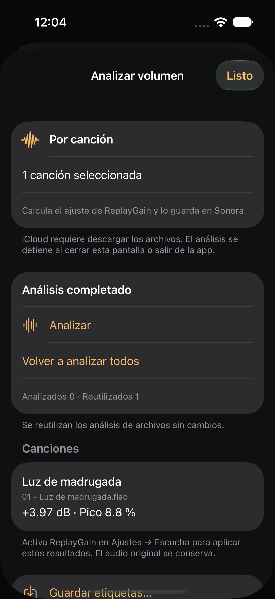
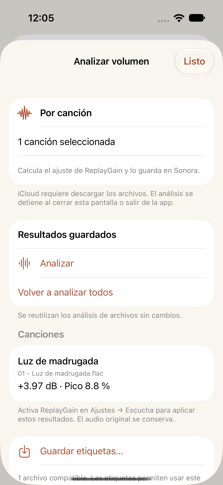
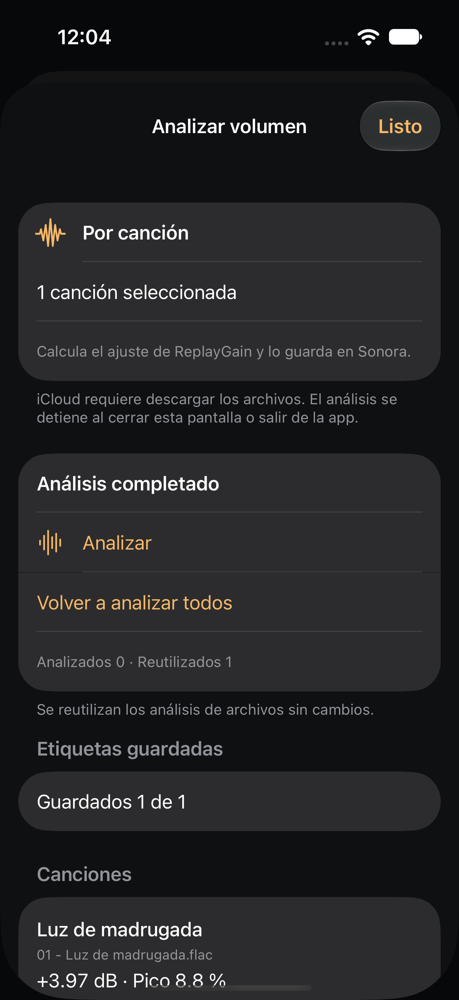
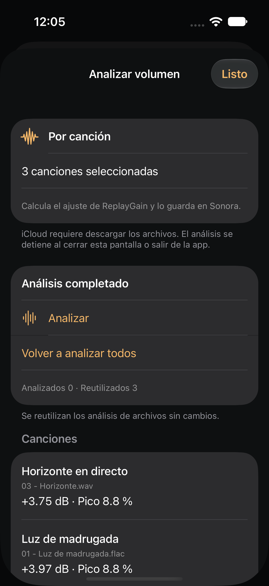
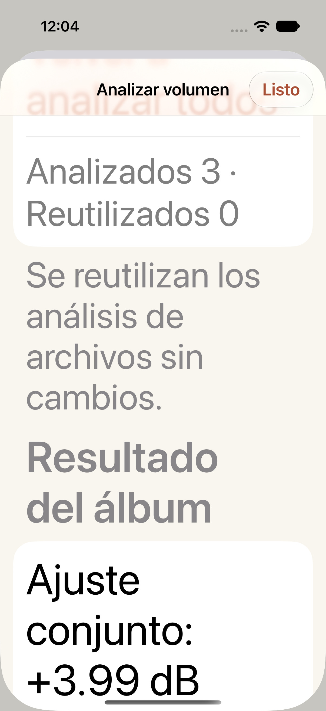

# ReplayGain analysis: native screens

Captured from Sonora on iPhone 17 Simulator / iOS 27, 2026-10-16. The files and music are synthetic QA fixtures. These are native app captures; the [analysis guide](../../replaygain-analysis.md) describes the behavior and validation limits. [captures.json](captures.json) records source tests and image hashes.

| Noche: completed song result | Papel: saved result after relaunch |
| --- | --- |
|  |  |

| Explicit file-tag save | Multiple songs, including a subfolder |
| --- | --- |
|  |  |

The album action was also exercised at the largest accessibility text size. The form scrolls so the text and controls retain their size.

